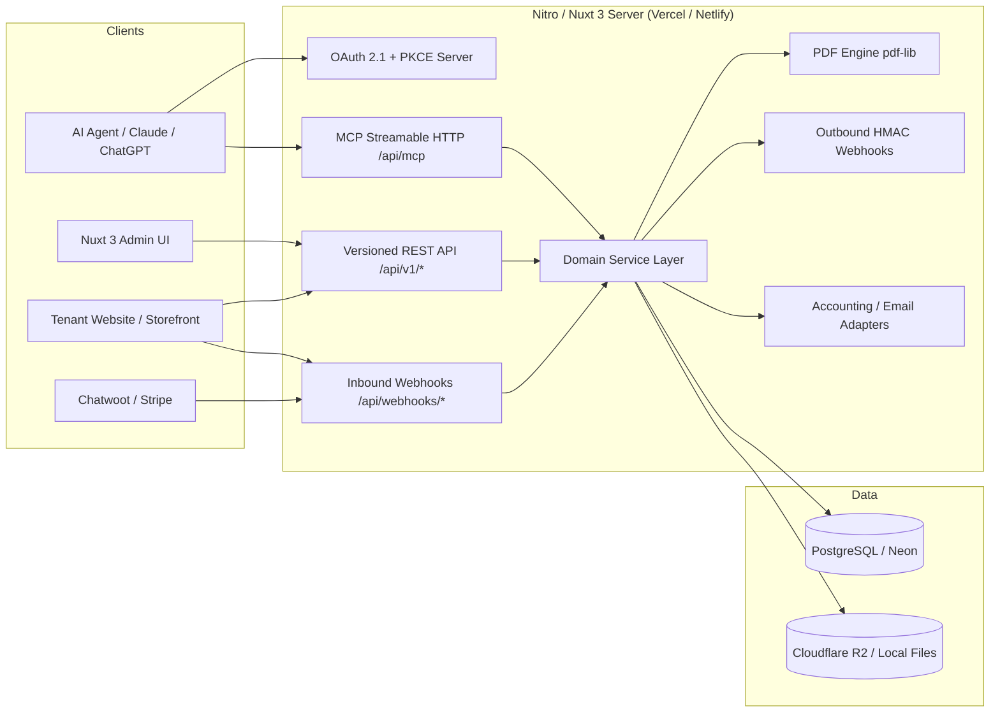
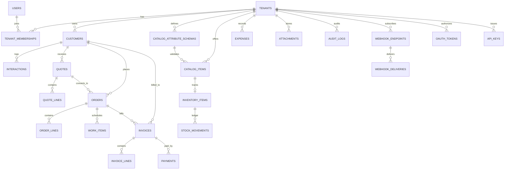

# Back Office Platform — Architecture & Data Model

## 1. System Overview

**Back Office** is a multi-tenant, API-first operational platform for small businesses managed by BWE operators and accessed by business owners via AI agents (MCP over Streamable HTTP + OAuth 2.1), external websites/webhooks, and the Nuxt 3 operator/tenant web UI.

## 2. Core Architectural Rules

1. **API-First**: Every capability lives in `server/services/*` and is exposed under `/api/v1/*` with a generated OpenAPI 3.1 contract at `/api/v1/openapi.json`. The Nuxt UI and the MCP server are thin clients of the same service/API layer.
2. **Strict Tenant Isolation**: Every tenant-scoped table carries `tenant_id`. Tenant context is resolved exclusively from authenticated credentials (JWT, OAuth token, API key, or operator `X-Tenant-Id` header verified against `tenant_memberships`) — never from request payloads.
3. **Server as Referee**: All monetary calculations use integer cents and are computed exclusively on the server. Client-supplied totals are validated and rejected with `422` if they do not match.
4. **Draft-Then-Confirm**: Quotes, Invoices, Expenses, and Inventory Stock Adjustments follow a draft → approve lifecycle. Approval calls require an explicit `version` matching the current record (optimistic concurrency, `409` on mismatch).
5. **Idempotency & Rate Limiting**: External write endpoints support `Idempotency-Key` (replaying identical requests and rejecting payload mismatches with `409`). Sliding-window rate limiting guards all API routes.
6. **Immutable Auditability & Soft Deletes**: Every write executes inside a PostgreSQL transaction alongside an immutable `audit_logs` entry recording actor type, actor ID, action, entity, and before/after snapshots. Domain records use `deleted_at` soft deletes; `stock_movements` and `audit_logs` are append-only.
7. **Prompt-Injection Defense**: Raw inbound customer messages are flagged (`contains_external_input = true`) and withheld from MCP tool responses.

## 3. Entity Relationship Diagram

## 4. Layering Convention

- **Routes (`server/api/**`)**: Parse & validate request via Zod schemas (`server/schemas/*`), enforce auth + scopes (`requireAuth`), enforce idempotency (`withIdempotency`), call a single service method, return envelope `{ data, meta? }` or `{ error }`.
- **Services (`server/services/*`)**: Pure business logic, server-side math, optimistic concurrency checks, DB transactions (`db.transaction(...)`), audit logging, and webhook event emission.
- **Database (`server/db/*`)**: Drizzle ORM PostgreSQL schema, migrations, and connection manager (supports `pg` / Neon via `DATABASE_URL` and `@electric-sql/pglite` for zero-config tests and local dev).
- **MCP (`server/services/mcp.service.ts` & `server/api/mcp.ts`)**: Thin adapter over the service layer using `@modelcontextprotocol/sdk` Streamable HTTP transport and OAuth 2.1 Bearer tokens.
